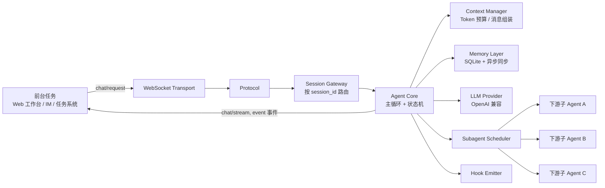
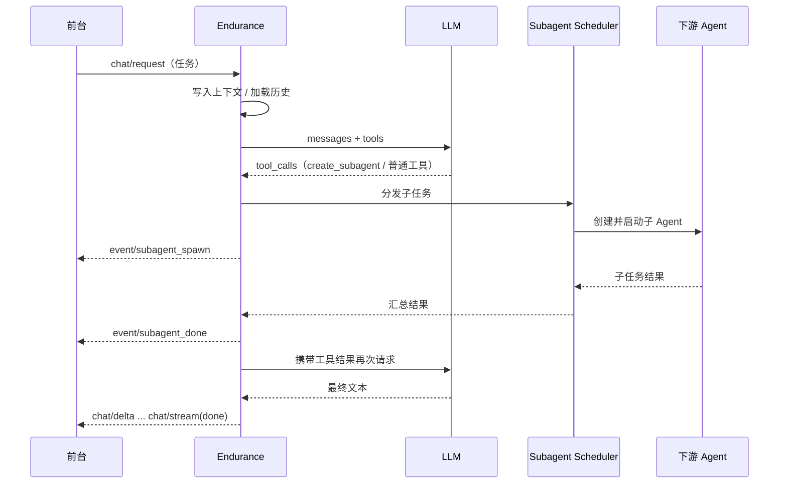

# Endurance（永恒者号）

> 工作平台的 super-agent 调度员：接收前台任务，调度下游 Agent 执行，汇总结果回传。

Endurance 是一个以 Go 开发的 Agent 运行时，但这只是它的实现形态。它在工作平台中承担的角色是 **super-agent 调度员（Orchestrator）**：前台只需要把任务交给它，由它负责理解任务、拆解任务、把子任务分发给下游 Agent，跟踪执行进度，并把最终结果整理后回传前台。

名字取自电影《星际穿越》中用于探索未来的飞船，寓意持久、可扩展、可协作。

## 目录

- [项目定位](#项目定位)
- [三个角色与职责边界](#三个角色与职责边界)
- [核心职责](#核心职责)
- [架构总览](#架构总览)
- [核心概念](#核心概念)
- [一次任务的完整流程](#一次任务的完整流程)
- [接入与使用约定](#接入与使用约定)
- [仓库结构](#仓库结构)
- [开发状态与路线图](#开发状态与路线图)
- [相关文档](#相关文档)
- [参与开发](#参与开发)
- [许可证](#许可证)

## 项目定位

工作平台里的任务通常跨越多个专业领域：数据分析、代码修改、文档撰写、外部系统操作……如果让前台直接对接每一个执行单元，前台会逐渐变成一张难以维护的集成网。

Endurance 的定位是在前台与下游 Agent 之间放一层 **super-agent**：

- **对前台**，它是唯一的任务入口和结果出口。前台提交自然语言任务，通过 WebSocket 接收进度事件与最终结果。
- **对下游**，它是调度者。它把任务拆成可执行的子任务，分发给具备相应能力的子 Agent，并行推进有独立性的部分，串行推进有依赖的部分。
- **对它自己**，它保留会话、上下文与记忆，跨轮次、跨会话地理解"这个任务进行到哪一步了"。

换句话说：**Endurance 不承诺自己完成所有事，它承诺对任务的结果负责。**

### 目标场景

- 工作台 / IM / 网页等前台把用户任务转发给 Endurance，Endurance 负责落地执行。
- 一个任务需要多个下游 Agent 协作，例如先检索资料、再分析、再产出文档。
- 下游 Agent 的执行过程需要以流式事件的形式回显给前台，用户能看到工具调用与子 Agent 的进展。
- 会话可能断开重连，任务上下文需要恢复，而不是从零开始。

### 第一阶段不包含

- 用户认证与鉴权（第一版暂不实现）。
- 前台 UI 本身（Endurance 只提供协议与接口，不提供页面）。
- 下游 Agent 的具体业务实现（由接入方通过 Tool / Skill / 子 Agent 扩展）。
- 向量检索等高级长期记忆能力（MVP 阶段先做 SQLite 持久化）。

## 三个角色与职责边界

| 角色 | 典型形态 | 职责 | 对 Endurance 的接口 |
|------|----------|------|---------------------|
| 前台 | Web 工作台、IM 机器人、任务系统 | 收集用户任务、展示流式进度、展示最终结果、支持取消与重连 | WebSocket 协议（`chat/request`、`chat/stream`、`event/*`、`error`、`ping/pong`） |
| Endurance（super-agent 调度员） | 常驻服务进程 | 任务受理与澄清、拆解、调度下游、汇总结果、维护会话与记忆 | 对上：WebSocket；对下：Tool / Skill / Subagent |
| 下游 Agent | 内部子 Agent 或外部 Agent 服务 | 执行具体的子任务，返回结果或错误 | 子 Agent 由 `SubagentScheduler` 创建；外部服务通过 Tool / Skill 包装接入 |

职责边界的原则：

- 需求澄清、任务拆解、失败重试与降级由 Endurance 负责，前台不重新实现调度逻辑。
- 下游 Agent 只对子任务负责，不直接与前台通信，也不修改父 Agent 的上下文。
- 前台只消费协议事件，不感知内部有多少个子 Agent、用了哪些 Tool。

## 核心职责

### 1. 对接前台任务

Endurance 通过 WebSocket 接收任务，并把执行过程实时回传。一次会话对应一个 `session_id`，任务在会话内通过 `chat/request` 提交；连接断开后实例会保留一段时间，允许前台重连恢复。

### 2. 理解与拆解任务

收到任务后，Endurance 用 LLM 判断：

- 这个任务是否可以由自己直接用 Tool 完成；
- 是否需要拆成多个子任务；
- 子任务之间是否存在依赖，能否并行。

### 3. 分发与调度下游 Agent

调度由 `SubagentScheduler` 统一负责，目前设计两种模式：

- **parallel_tool（并行工具）**：同一批无依赖的 tool_calls 分发到多个 goroutine 并行执行，结果统一收集。
- **task_decomposition（任务分解）**：LLM 调用内置工具 `create_subagent` 创建子 Agent，由调度器维护依赖关系并按 DAG 依次推进。

子 Agent 拥有独立的上下文，只能读取父 Agent 的摘要，不能修改父 Agent 的内存，从而保证隔离与安全。

### 4. 汇总结果并回传

子 Agent 与 Tool 的执行结果回到主循环，由 Endurance 决定是继续规划、重试还是生成最终答复；最终文本以流式帧推送给前台。

### 5. 上下文、会话与记忆

- **Session**：一次完整对话的持久化单元，支持父子关系。
- **Context**：当前轮次的工作区，负责 messages 组装、token 预算、滑动窗口截断与系统 Prompt 注入。
- **Memory**：跨轮次、跨会话持久化；三层存储为内存缓存、本地 SQLite、异步远端同步（Redis / DB）。

### 6. 可扩展

- **Tool**：最原子的能力单元，Go 代码内置并注册到 `ToolRegistry`。
- **Skill**：面向任务的高层能力，动态加载，可组合多个 Tool；MVP 阶段采用配置式。
- **Hook**：在 LLM 请求前后、Tool 调用前后、WebSocket 消息收发前后、Session 状态变化时插入自定义逻辑（日志、审计、限流等）。

## 架构总览

从"调度员"视角看，任务从入口流入，经拆解与调度后，结果与进度再流回前台：



分层与模块边界（Transport、Protocol、Gateway、Core、Subagent、Tool、Skill、Context、Memory、Provider）的完整定义见架构设计文档。

**依赖原则**：外层依赖内核，内核不感知外层；内核模块之间通过 `interface` 调用；Hook 作为横切关注点显式接入主循环。

## 核心概念

| 概念 | 说明 |
|------|------|
| Task | 前台提交的一次任务，是一次 `chat/request` 及其后续执行过程 |
| Session | 一次完整对话的持久化单元，包含 `parent_session_id` 以表达父子关系 |
| Agent | 运行主循环与状态机的实例，状态为 `idle` / `thinking` / `acting` / `streaming` / `paused` / `error` |
| Subagent | 由调度器创建、拥有独立上下文的下游执行单元 |
| Tool | 原子能力，输入输出为明确的 struct / JSON Schema |
| Skill | 面向任务的高层能力，可动态加载，组合多个 Tool |
| Hook | 生命周期扩展点，可拦截或观察 LLM、Tool、WebSocket、Session 事件 |
| Context | 当前轮次的消息工作区，负责 token 预算与窗口截断 |
| Memory | 跨轮次、跨会话的持久化历史 |

## 一次任务的完整流程



要点：

1. 每次 LLM 调用都有最大轮次保护（默认 15 轮），并有单次 LLM 与 Tool 超时。
2. 错误分级处理：`recoverable` 自动重试；`user_visible` 作为 tool_result 返回给 LLM 自行修正；`fatal` 与 `session_fatal` 通过 `error` 帧通知前台。
3. 所有 Server 到 Client 的消息都带 `id`，便于前台做请求-响应关联。

## 接入与使用约定

> **当前状态**：仓库仍处于架构设计阶段，尚未包含可运行代码。以下为设计约定，用于前台与下游 Agent 对齐集成方式，具体字段在协议实现时冻结。

### 使用步骤（接入方视角）

1. **部署 Endurance 服务**：作为常驻进程运行，配置 LLM Provider 与可用的 Tool / Skill（待实现）。
2. **前台建立连接**：通过 WebSocket 连入，为一次会话创建或复用一个 `session_id`。
3. **提交任务**：发送 `chat/request`，随后消费 `chat/delta`、`chat/stream` 与 `event/*` 帧更新界面。
4. **接收结果**：`chat/stream` 以 `done: true` 标记一次 LLM 调用结束，最终答复通过 `chat/delta` 流式呈现；`error` 帧表示失败。
5. **断线恢复**：携带同一 `session_id` 重连，恢复未完成的会话。

### 前台接入

建立 WebSocket 连接后，前台发送统一信封格式的 JSON 帧：

```json
{
  "type": "chat/request",
  "id": "uuid-v4",
  "session_id": "sess-xxxxx",
  "payload": { }
}
```

`payload` 的具体字段尚未冻结。前台需要处理的服务端帧：

| 帧类型 | 用途 |
|--------|------|
| `chat/stream` | 一次 LLM 调用的流式输出，`done: true` 表示结束 |
| `chat/delta` | 打字机式文本片段 |
| `event/tool_start` / `event/tool_end` | 工具开始与结束，可据此展示执行进度 |
| `event/subagent_spawn` / `event/subagent_done` | 下游 Agent 创建与完成 |
| `error` | 运行时错误，携带字符串 `code` 与 `message` |
| `ping` / `pong` | 心跳 |

### 下游 Agent 接入

- **内部子 Agent**：由 LLM 触发 `create_subagent` 创建，声明 `goal`、`required_tools` 与父上下文摘要。
- **外部 Agent 服务**：通过自定义 Tool / Skill 包装成原子能力，由 Endurance 在规划阶段调用。

```json
{
  "name": "create_subagent",
  "arguments": {
    "goal": "分析项目中的 API 路由",
    "required_tools": ["read_file", "grep"],
    "parent_context_summary": "用户要求重构路由代码"
  }
}
```

### 开发与运行

实现完成后，典型启动方式为配置 LLM Provider 后启动服务，前台通过 WebSocket 接入；架构设计文档描述了 MVP 的模块顺序：

1. WebSocket Transport → Protocol → Agent Core → Context Manager → LLM Provider（OpenAI 兼容）→ 基础 Tool（`bash`、`read_file` 等）。
2. 延后：Skill 高级工作流、Memory 向量检索、Subagent 的 DAG 分解、复杂 Hook。

在代码落地前，本文不提供尚不存在的命令行参数，避免误导接入方。

## 仓库结构

```text
.
├── README.md                          # 项目定位与用法（本文）
├── docs/superpowers/specs/
│   └── 2026-04-02-endurance-agent-architecture-design.md   # 架构设计文档
└── LICENSE                            # Apache License 2.0
```

## 开发状态与路线图

**当前状态：架构设计阶段，尚无实现代码。**

- [x] 明确项目定位：工作平台 super-agent 调度员
- [x] 完成 Agent 架构设计（协议、调度、上下文、记忆、Hook）
- [ ] MVP：WebSocket 接入、主循环、上下文管理、OpenAI Provider、基础 Tool
- [ ] 子 Agent 创建与结果回收
- [ ] 会话重连与 SQLite 持久化
- [ ] Skill 配置式加载与 Hook 机制
- [ ] Memory 远端异步同步、向量检索（后续）

## 相关文档

- [Endurance Agent 架构设计文档](docs/superpowers/specs/2026-04-02-endurance-agent-architecture-design.md)

## 参与开发

- 先阅读架构设计文档，确认要扩展的层次（Transport / Core / Tool / Skill / Hook）。
- 遵循模块依赖原则：内核不感知外层，模块之间通过接口调用。
- 新增 Tool 时提供明确的输入输出 schema，并注册到 `ToolRegistry`。
- 涉及调度行为的变化，请同时更新设计文档与本文档中受影响的约定。

## 许可证

[Apache License 2.0](LICENSE)
